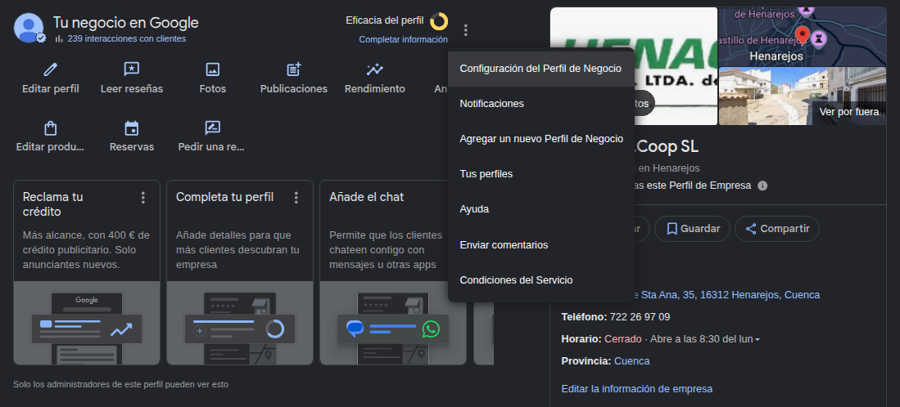

# Local SEO

## Map Pack

- Relevance: GBP matches user's search intent. Ex: categories.
- Prominence: review count, review sentiment, inbound links to website and citations (consistent directory listings - NAP).
- Distance.

!!! note "Tools"
    - Geo grid (https://www.localfalcon.com).

==Configuración del Perfil de Negocio== -> ==Usuarios y acceso== -> ==Añadir==

## Organic results

They're not meaningfully proximity-sensitive within a city.

!!! note "Tools"
    - Standard rank tracker.

### On-Page SEO

Optimize the content of the pages: titles, meta, headings, content depth, schema.

#### Tools

!!! note "Tools"
    - Keyword Planner.
    - Local SERP Checker:
        - https://www.brightlocal.com/local-search-results-checker/
        - https://valentin.app
    - Detailed SEO extension.
    - Keyword Surfer.

### Off-Page SEO

Backlinks.

!!! note "Tools"
    

### Technical SEO

Search engines can easily crawl and index your pages, site speed optimization, mobile-friendliness, structured data.

!!! note "Tools"
    - GSC.
    - PageSpeed Insights (https://pagespeed.web.dev).
    - Rich Results Test (https://search.google.com/test/rich-results).
    - Screaming Frog.

